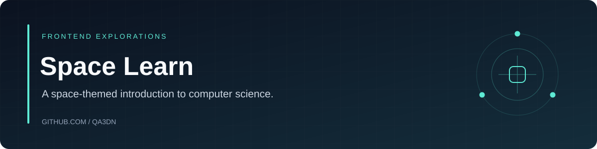

# Space Learn

A small, space-themed landing page introducing computer science and linking visitors to a student community. An early frontend project focused on HTML, CSS, typography, imagery, and page composition.

## Explore

- Space-inspired hero section and background imagery.
- Introductory content about computer science.
- A link to the student Telegram community.
- Static source with no framework or build step.

## Run locally

Clone the repository and open `index.html` in a browser, or serve the folder with a local static server:

```bash
python -m http.server 8080
```

Then open `http://localhost:8080`.

## Source map

| Path | Purpose |
|---|---|
| `index.html` | Page structure and content |
| `styles.css` | Visual styling |
| `image/` | Project imagery |

## Project scope

This repository is a static learning project. Assets retain their respective ownership; no new software or asset license is added by this documentation.
